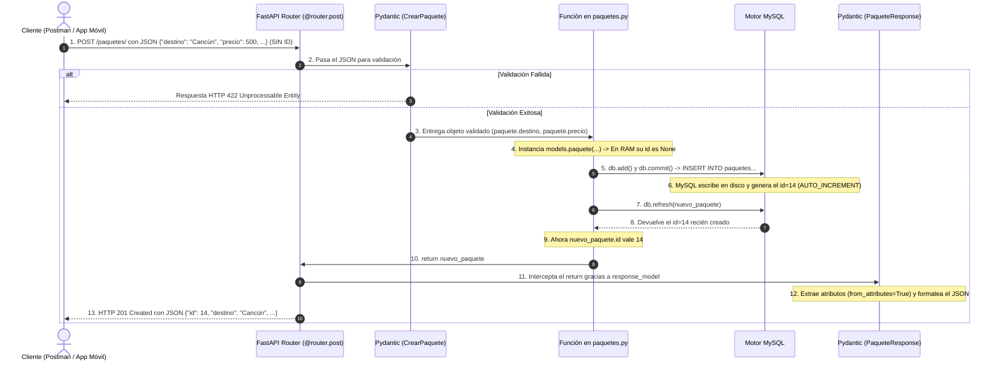

# Guía Pedagógica: De Listas en Memoria a una API REST con Base de Datos Relacional

Bienvenido a esta guía. Si estás transitando el paso de manejar datos con listas en memoria a construir una API profesional conectada a una base de datos relacional con **FastAPI** y **SQLAlchemy**, este documento detalla los conceptos, las diferencias arquitectónicas y el flujo técnico fundamental que necesitas dominar.

---

## 1. Comparativa de Arquitectura: Proyecto Base vs. Proyecto Mejorado

### Proyecto Base (`agenciaviajes`)
En la versión inicial, todo el sistema residía en un único archivo (`main.py`) y los datos se almacenaban en variables globales:

* **Almacenamiento**: Listas de diccionarios en memoria RAM (`paquetes_turisticos = []`, `clientes = []`, `reservas = []`).
* **Ciclo de Vida de los Datos**: Volátil. Al apagar o reiniciar el servidor (`uvicorn`), toda la información creada desaparecía.
* **Integridad Referencial**: Manual. Para relacionar una reserva con un cliente o paquete, se iteraba con bucles `for` buscando IDs coincidentes.
* **Estructura del Proyecto**: Monolítica en un solo archivo. Lógica HTTP, modelos y persistencia mezclados.

### Proyecto Mejorado (`agenciaviajes-mejorado`)
En la versión evolucionada, el sistema adopta una arquitectura modular basada en separación de responsabilidades:

* **Almacenamiento**: Persistencia real en disco mediante un motor de base de datos relacional (**MySQL**).
* **Ciclo de Vida de los Datos**: Permanente. Los datos sobreviven a reinicios, caídas del servicio y despliegues.
* **Integridad Referencial**: Garantizada por el motor de base de datos mediante **Claves Foráneas (`ForeignKey`)**. Si un ID no existe, la base de datos rechaza la operación.
* **Estructura del Proyecto**:
  * `database.py`: Configuración del motor, pool de conexiones y sesión.
  * `models.py`: Entidades relacionales (tablas) mapeadas con el ORM de SQLAlchemy.
  * `schemas.py`: Contratos de datos (DTOs) validados con Pydantic para peticiones y respuestas.
  * `Routers/`: Módulos independientes por dominio (`paquetes.py`, `clientes.py`, `reservas.py`).
  * `main.py`: Punto de entrada que inicializa la aplicación y registra las rutas.

---

## 2. Cuadro Comparativo de Operaciones

| Aspecto | Con Listas en Memoria (`agenciaviajes`) | Con Base de Datos y ORM (`agenciaviajes-mejorado`) |
| :--- | :--- | :--- |
| **Consultar todos** | `return lista` | `db.query(models.Paquete).all()` |
| **Buscar por ID** | Bucle `for item in lista: if item["id"] == id` | `db.query(models.Paquete).filter(models.Paquete.id == id).first()` |
| **Insertar** | `lista.append(nuevo_diccionario)` | `db.add(nuevo_objeto)` seguido de `db.commit()` |
| **Eliminar** | `lista.remove(item)` | `db.delete(item)` seguido de `db.commit()` |
| **Actualizar** | Mutación directa del diccionario en el índice | Modificación de propiedades del objeto recuperado y `db.commit()` |
| **Generación de ID** | `len(lista) + 1` (propenso a duplicados al borrar) | `AUTO_INCREMENT` nativo y seguro de MySQL |

---

## 3. Cómo Funciona FastAPI con una Base de Datos Relacional

El flujo de trabajo se divide en capas coordinadas por FastAPI:

### A. La Sesión de Base de Datos y su Ciclo de Vida (`database.py`)
Conectar a una base de datos requiere recursos de red. Para optimizar, se crea un canal temporal llamado **Sesión** por cada petición:

```python
def get_db():
    db = SessionLocal()  # 1. Abre conexión
    try:
        yield db         # 2. La entrega a la ruta
    finally:
        db.close()       # 3. La cierra SIEMPRE al terminar la respuesta
```

### B. Inyección de Dependencias (`Depends`)
En las funciones de los routers se define el parámetro `db: Session = Depends(get_db)`. FastAPI ejecuta `get_db()`, suministra la sesión a la función y, una vez enviada la respuesta al cliente, ejecuta el bloque `finally` para liberar la conexión al pool.

### C. La Separación entre Schemas (Pydantic) y Models (SQLAlchemy)
* **`models.py` (SQLAlchemy)**: Representa la tabla física en la base de datos. Se utiliza para consultar y persistir datos.
* **`schemas.py` (Pydantic)**: Representa el JSON que viaja por la red.
  * **Schema de Entrada (`Crear...`)**: Valida tipos, rangos numéricos y longitudes de texto antes de tocar la base de datos.
  * **Schema de Salida (`...Response`)**: Filtra datos sensibles, añade el `id` autoincremental y serializa la salida con `from_attributes = True`.

---

## 4. Desmitificando los "Response": ¿Por Qué son Estrictamente Necesarios?

La duda más común al comenzar es: *"Si ya tengo `CrearPaquete` con destino, precio y capacidad, ¿por qué tengo que crear otra clase `PaqueteResponse` casi idéntica solo para devolver datos?"*.

La respuesta radica en el patrón de arquitectura llamado **DTO (Data Transfer Object)**. No se trata de escribir código duplicado por capricho, sino de resolver cuatro problemas críticos de diseño:

### 1. La Asimetría de la Información (Lo que entra nunca es igual a lo que sale)
Cuando un cliente hace una petición `POST` para dar de alta un registro:
* **El cliente NO tiene el `id`**: El identificador único no existe todavía, lo genera MySQL de forma autoincremental al momento de hacer el `INSERT`.
* **El cliente NO debe controlar estados internos**: En una reserva, el campo `cancelada` debe crearse siempre en `False`. Si usamos un único esquema donde `cancelada` esté presente, un usuario malintencionado podría enviar `{"cancelada": True}` en el cuerpo del request y crear reservas inactivas desde el primer segundo.

Al separar los esquemas:
* `CrearReserva` solo solicita lo que el cliente tiene permitido definir (`cliente_id`, `paquete_id`, `numero_de_personas`).
* `ReservaResponse` le entrega al cliente el resultado consolidado (`id: 1`, `cancelada: False`, etc.).

### 2. Seguridad y Prevención de Fuga de Datos (Data Leaks)
Imagina una entidad `Usuario` en tu base de datos:
```python
# models.py
class Usuario(Base):
    id = Column(Integer, primary_key=True)
    nombre = Column(String(50))
    email = Column(String(100))
    password_hash = Column(String(255))      # ¡DATO SENSIBLE!
    intentos_fallidos = Column(Integer)     # Campo interno de seguridad
```
* **Si NO usas Response**: Al hacer `return usuario` en tu endpoint, FastAPI serializa el objeto de SQLAlchemy tal como está. El navegador o cliente recibirá en el JSON el `password_hash` y los datos internos del sistema.
* **Si usas `UsuarioResponse`**:
  ```python
  class UsuarioResponse(BaseModel):
      id: int
      nombre: str
      email: str
  ```
  Pydantic actúa como un **filtro estricto (cortafuegos)**: descarta automáticamente `password_hash` e `intentos_fallidos`, enviando por internet únicamente los datos públicos autorizados.

### 3. Desacoplamiento (Tu Base de Datos no es tu API Pública)
Las bases de datos cambian: se renombran tablas, se optimizan tipos de columnas o se agregan campos de auditoría (`created_at`, `deleted_at`, `version_lock`).
* Si expones tus modelos de SQLAlchemy directamente, cualquier cambio en tu base de datos romperá la aplicación móvil o el frontend de tus clientes.
* El esquema **Response** es el **contrato oficial** con el mundo exterior. Tu base de datos puede evolucionar internamente, pero la API seguirá respondiendo el JSON acordado a través de su `Response`.

### 4. ¿Por qué es obligatorio `from_attributes = True`?
Pydantic está diseñado por defecto para leer **diccionarios de Python** (`dato["id"]`).
Sin embargo, SQLAlchemy devuelve **instancias de clases del ORM** (`dato.id`).

Cuando configuras:
```python
class Config:
    from_attributes = True
```
Le indicas a Pydantic: *"Cuando te pase un objeto de base de datos, no intentes leerlo como diccionario con corchetes; lee sus atributos directamente usando la sintaxis de punto (`.`)"*. Sin esta configuración, FastAPI no podrá transformar tus modelos de SQLAlchemy a JSON y arrojará un error de serialización.

---

### 5. Mapa del Viaje de la Información (Data Flow Lifecycle)

A continuación se muestra el ciclo de vida completo de los datos cuando un cliente crea un recurso (por ejemplo, un paquete):



#### Tabla de Evolución del Estado de los Datos

| Momento | Dónde está la información | ¿Qué contiene el campo `id`? | ¿Quién lo generó? |
| :--- | :--- | :--- | :--- |
| **Petición del Cliente** | En el cable de red (JSON HTTP) | **No existe** en el JSON | Nadie (el cliente no lo conoce) |
| **Instanciación en Python** | Memoria RAM (`models.paquete(...)`) | `None` | Todavía no se ha guardado |
| **Ejecución de `db.commit()`** | Disco duro de MySQL | **`14`** (o el siguiente autoincremental) | **El motor de MySQL** |
| **Ejecución de `db.refresh()`** | Objeto Python en memoria | **`14`** | `refresh` lo trajo de MySQL |
| **Filtrado `PaqueteResponse`** | Interceptor de FastAPI | **`14`** empaquetado en el JSON final | Pydantic para el cliente |

---

### D. Atomicidad en Transacciones (ACID)
Al realizar una operación como una reserva:
1. Se consulta el paquete y se restan sus cupos disponibles.
2. Se instancia el nuevo registro de reserva.
3. Se invoca `db.commit()`.

Ambas modificaciones (la actualización de cupos y la creación de la reserva) se consolidan en una única transacción de MySQL. Si ocurre algún error en el proceso, ninguna de las dos modificaciones se almacena, evitando datos corruptos o desfasados.

---

## 5. Ejemplo Práctico: Adaptar el Patrón a Otro Proyecto (Sistema de Biblioteca)

Para evidenciar la reutilización de este diseño, observemos cómo se modela un sistema de préstamos de libros:

### A. Modelos de Base de Datos (`models.py`)
```python
from sqlalchemy import String, ForeignKey
from sqlalchemy.orm import Mapped, mapped_column, relationship
from database import Base

class Libro(Base):
    __tablename__ = "libros"

    id: Mapped[int] = mapped_column(primary_key=True, index=True)
    titulo: Mapped[str] = mapped_column(String(100), nullable=False)
    autor: Mapped[str] = mapped_column(String(50), nullable=False)
    ejemplares_disponibles: Mapped[int] = mapped_column(nullable=False)

    prestamos: Mapped[list["Prestamo"]] = relationship(back_populates="libro")


class Prestamo(Base):
    __tablename__ = "prestamos"

    id: Mapped[int] = mapped_column(primary_key=True, index=True)
    usuario_nombre: Mapped[str] = mapped_column(String(50), nullable=False)
    activo: Mapped[bool] = mapped_column(default=True)

    # Clave Foránea apuntando a la tabla 'libros'
    libro_id: Mapped[int] = mapped_column(ForeignKey("libros.id"), nullable=False)

    libro: Mapped["Libro"] = relationship(back_populates="prestamos")
```

### B. Esquemas de Validación (`schemas.py`)
```python
from pydantic import BaseModel, Field

class LibroCreate(BaseModel):
    titulo: str = Field(min_length=1, max_length=100)
    autor: str = Field(min_length=2, max_length=50)
    ejemplares_disponibles: int = Field(gt=0)

class LibroResponse(LibroCreate):
    id: int

    class Config:
        from_attributes = True

class PrestamoCreate(BaseModel):
    usuario_nombre: str = Field(min_length=2, max_length=50)
    libro_id: int = Field(gt=0)

class PrestamoResponse(PrestamoCreate):
    id: int
    activo: bool

    class Config:
        from_attributes = True
```

### C. Endpoint de Transacción (`Routers/prestamos.py`)
```python
from fastapi import APIRouter, Depends, HTTPException, status
from sqlalchemy.orm import Session
from database import get_db
import models
import schemas

router = APIRouter(prefix="/prestamos", tags=["Préstamos"])

@router.post("/", response_model=schemas.PrestamoResponse, status_code=status.HTTP_201_CREATED)
def registrar_prestamo(datos: schemas.PrestamoCreate, db: Session = Depends(get_db)):
    # 1. Validar existencia del recurso
    libro = db.query(models.Libro).filter(models.Libro.id == datos.libro_id).first()
    if not libro:
        raise HTTPException(status_code=404, detail="El libro especificado no existe")

    # 2. Validar regla de negocio
    if libro.ejemplares_disponibles <= 0:
        raise HTTPException(status_code=400, detail="No quedan ejemplares disponibles para préstamo")

    # 3. Modificar stock
    libro.ejemplares_disponibles -= 1

    # 4. Crear registro dependiente
    nuevo_prestamo = models.Prestamo(
        usuario_nombre=datos.usuario_nombre,
        libro_id=datos.libro_id,
        activo=True
    )

    db.add(nuevo_prestamo)
    db.commit()              # Ambas operaciones se aplican de manera atómica
    db.refresh(nuevo_prestamo)
    return nuevo_prestamo
```

---

## 6. Reglas de Oro y Lecciones Aprendidas

1. **`create_all()` no altera tablas existentes**: Si modificas el nombre de una columna en `models.py`, `create_all()` no modificará la tabla en MySQL si esta ya fue creada previamente. Debes eliminar la tabla en desarrollo o utilizar herramientas de migración (**Alembic**).
2. **Sintaxis de Claves Foráneas**: En `ForeignKey("tabla.columna")` se debe referenciar el nombre exacto de la tabla (usualmente en plural) seguido de un punto y el nombre de la columna.
3. **Tipado moderno en SQLAlchemy 2.0**: Usa siempre `Mapped[tipo] = mapped_column(...)` para asegurar compatibilidad total con analizadores estáticos de tipos (Pylance/Pyright) y evitar advertencias sobre asignaciones a objetos `Column`.
4. **Respeto a los códigos de estado HTTP**:
   * `200 OK`: Consultas y actualizaciones exitosas con contenido.
   * `201 CREATED`: Creación exitosa de recursos.
   * `204 NO CONTENT`: Eliminación exitosa sin cuerpo de retorno.
   * `400 BAD REQUEST`: Errores de reglas de negocio (sin cupos, saldo insuficiente).
   * `404 NOT FOUND`: Recurso no encontrado por ID.
   * `422 UNPROCESSABLE ENTITY`: Errores automáticos de formato y validación disparados por Pydantic.
